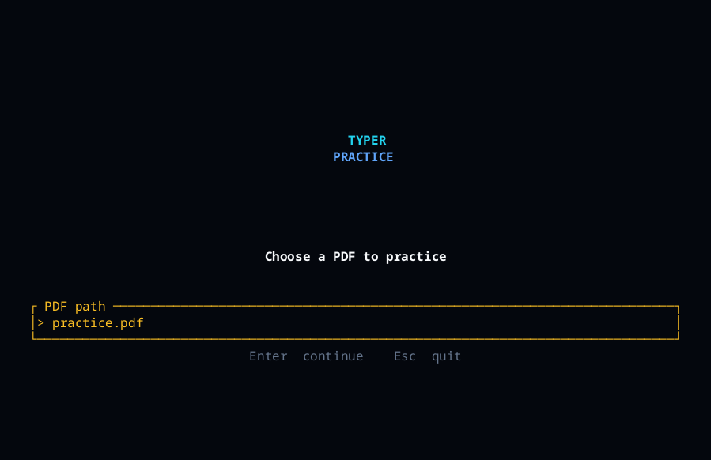

  

  <picture>
    <source media="(prefers-color-scheme: dark)" srcset="https://readme-typing-svg.demolab.com?font=Fira+Code&size=20&duration=2800&pause=700&color=67E8F9&center=true&vCenter=true&width=780&lines=Type+what+you+read.;Race+a+ghost+set+to+your+personal+best.;See+speed+and+accuracy+as+you+type.;Continue+from+the+same+batch+next+time.">
    <source media="(prefers-color-scheme: light)" srcset="https://readme-typing-svg.demolab.com?font=Fira+Code&size=20&duration=2800&pause=700&color=0E7490&center=true&vCenter=true&width=780&lines=Type+what+you+read.;Race+a+ghost+set+to+your+personal+best.;See+speed+and+accuracy+as+you+type.;Continue+from+the+same+batch+next+time.">
    
  </picture>

  
  
  

  
  

## About

EscapeTypo turns a PDF into short typing batches inside your terminal. Use your own books, notes or papers, type the words you have chosen, and watch your speed and accuracy change. Once you set a personal best, a ghost marker moves at that pace, giving you something to chase.

  

> **Read with purpose. Type with focus. Improve one session at a time.**

## See it in action

  

A short session: continue with a PDF, type the lines, and watch your stats change.

## What you can do

- Practise with any PDF that has selectable text.
- Work through the document four lines at a time.
- See your speed and accuracy update as you type.
- Race a ghost marker that is set to your personal best.
- Press Esc to save your progress and return to the same batch later.
- Practise without creating an account or uploading your files.

## Controls

| Key | Action |
| :--- | :--- |
| Any character | Type the highlighted character |
| Enter | Start a new line |
| Esc | Save your progress and quit |

## Getting started

1. Open the project in a terminal.
2. Start EscapeTypo.
3. Enter the path to a PDF and press Enter.
4. Begin typing the words shown on the screen.

You will need a terminal and a PDF with selectable text.

## Saving your progress

When you press Esc, EscapeTypo saves your current batch, your best speed and your latest stats on your computer. Open the same PDF again, and you can continue from the batch you were working on.

## Project status

The timer experience is still being refined. Suggestions, improvements and open-source contributions are welcome as the project continues to grow.

## Windows build availability

Windows builds are currently available as unsigned development builds. This keeps the project easy to try while the release and signing process is being prepared. Depending on your Windows security settings, you may see an unknown-publisher or SmartScreen notice when opening a build. An official signed GitHub Release will be provided when that process is complete.

  

